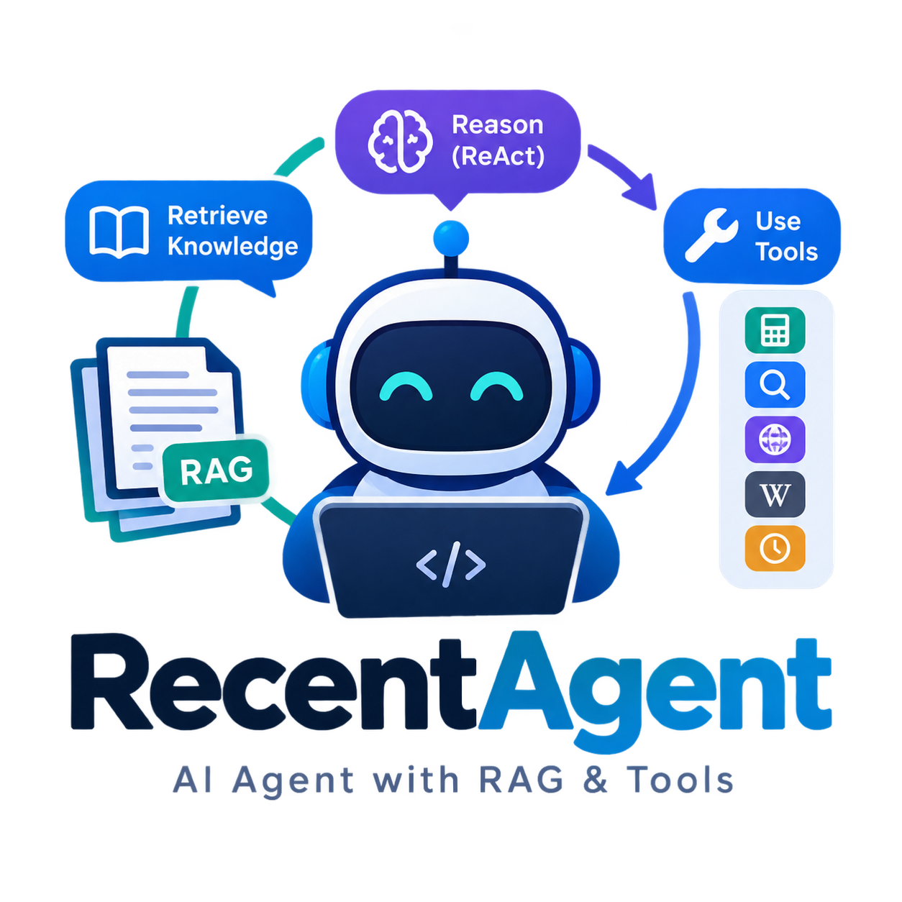
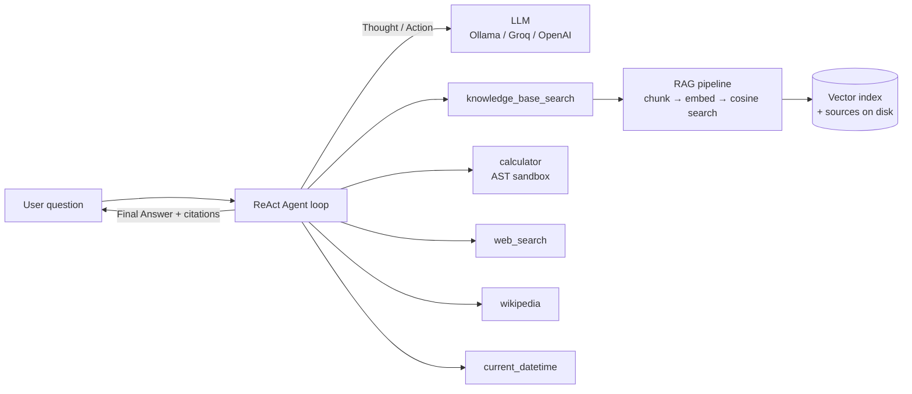

# 🤖 RecentAgent — AI Agent with RAG & Tools

<p align="center"></p>

A from-scratch **AI agent** that combines **Retrieval-Augmented Generation (RAG)**
with a **tool-using ReAct reasoning loop** — transparent, readable Python
(no heavyweight agent frameworks), a Streamlit chat UI, and full source
citations for every grounded answer.

> **Everything happens in front of you:** for each question you can watch the
> agent *think* (Thought → Action → Observation), see which tool it called,
> and verify the exact document passages it used.

## 🌐 Live web demo (testing only)

**[recentagent.vercel.app](https://recentagent.vercel.app)**

> ⚠️ **This hosted demo is for testing and previewing only — not the product.**
> - It runs a simplified web version of the agent (same ReAct loop, same prompts) on a free-tier Gemini key.
> - The knowledge base is the four sample documents; there is no upload, and conversations reset when the demo goes cold.
> - For the real experience — your own documents, your own provider, everything local — run RecentAgent on your machine (see below).
>
> The web demo code lives in the [`demo/`](demo/) folder and is fully separate from the app itself.

## 🧠 LLM providers

RecentAgent speaks the OpenAI-compatible protocol, so it works with:

| Provider | Setup |
|---|---|
| **Google Gemini** (recommended) | free key from [aistudio.google.com](https://aistudio.google.com) — set `GEMINI_API` (or `RECENT_API_KEY`) in your environment; model `gemini-flash-lite-latest` |
| Groq | free key from [console.groq.com](https://console.groq.com) |
| OpenAI | standard API key |
| Ollama | 100% local, no key — `ollama pull llama3.1` |

> RecentAgent is a **local-first** app: it runs on your own machine and talks
> directly to the provider you choose. The only hosted piece is the small testing
> demo above — your local documents never touch it.

## ✨ Features

| Capability | How it works |
|---|---|
| 📚 **RAG knowledge base** | Upload PDF / TXT / MD / DOCX → chunking → embeddings → cosine-similarity vector search → **cited answers** |
| 🧠 **ReAct agent loop** | Thought → Action → Action Input → Observation, implemented from scratch — every step shown live in the UI |
| 🔧 **Tool set** | `knowledge_base_search` (RAG), `calculator` (AST-sandboxed, injection-proof), `web_search` (DuckDuckGo, no API key), `wikipedia`, `current_datetime` |
| 🔌 **3 LLM providers** | **Ollama** (100% offline), **Groq** (free key), **OpenAI** — one OpenAI-compatible client covers all |
| 🧮 **Graceful degradation** | No embeddings API? Falls back to built-in TF-IDF lexical retrieval automatically |
| 💾 **Persistence** | Knowledge base survives restarts (JSON + NumPy index on disk) |
| 🖥️ **Transparent UI** | Reasoning trace + source passages expanders on every answer |

## 🏗️ Architecture



```
RecentAgent/
├── app.py                  # Streamlit UI (chat, trace, sources, KB manager)
├── core/
│   ├── config.py           # provider presets + settings
│   ├── llm.py              # OpenAI-compatible client (Ollama/Groq/OpenAI)
│   ├── embeddings.py       # neural (API) + TF-IDF fallback embedders
│   ├── rag.py              # chunking, knowledge base, vector search, persistence
│   ├── tools.py            # tool registry (incl. AST-safe calculator)
│   └── agent.py            # ReAct loop + robust output parsing
├── sample_docs/            # 4 demo documents (pre-loadable knowledge base)
├── demo/                   # hosted web demo — testing only (see demo/README.md)
├── tests/smoke_test.py     # offline unit tests (no API key required)
├── tests/real_ollama_test.py  # end-to-end test on a real local Ollama server
├── start.bat / stop.bat    # Windows one-click launch / stop
├── start.sh / stop.sh      # macOS / Linux launch / stop
└── requirements.txt
```

## 🚀 Quick start

Requires **Python 3.10+** ([python.org](https://python.org)).

### Windows
Double-click **`start.bat`** — it creates a virtual environment, installs
dependencies, and opens the app in your browser.

Stop later with **`stop.bat`**.

### macOS / Linux
```bash
./start.sh        # stop anytime with ./stop.sh
# or manually:
python3 -m venv .venv && source .venv/bin/activate
pip install -r requirements.txt
streamlit run app.py
```

The browser opens at `http://localhost:8501`. On first launch the **sample
documents are loaded for you** — try: *"What is RAG and why is it useful?"*

### Connecting an LLM brain

| Provider | Setup | Notes |
|---|---|---|
| **Ollama** (offline) | Install [Ollama](https://ollama.com), then `ollama pull llama3.1` and `ollama pull nomic-embed-text` | No internet needed at runtime; neural embeddings included |
| **Groq** (free) | Get a key at [console.groq.com](https://console.groq.com), paste it in the sidebar | Very fast; retrieval uses TF-IDF |
| **OpenAI** | Paste your API key in the sidebar | `gpt-4o-mini` + `text-embedding-3-small` |

Pick the provider in the sidebar, then click **🔌 Test connection**.

## 💬 Example questions to try

1. *"According to my documents, what are the stages of a RAG pipeline?"* —
   watch it call `knowledge_base_search`, then open **📚 Sources used**.
2. *"What is 12% of 45,000, and what day is it today?"* — chains `calculator`
   + `current_datetime`.
3. *"Search the web for the latest AI news"* — uses `web_search` with links.
4. Upload any PDF (syllabus, manual, report) and ask questions about it.

## 🧪 Tests

**Offline (no API key, no network):**

```bash
python tests/smoke_test.py
```

Covers chunking, TF-IDF retrieval, the AST calculator (including
code-injection rejection), ReAct parsing, and a full agent-loop simulation
with a scripted mock LLM.

**End-to-end on real Ollama (100% local, no API key):**

```bash
python tests/real_ollama_test.py
```

Runs the whole pipeline against your local Ollama server: connection probe,
embeddings, RAG retrieval, and two live ReAct agent runs (a cited knowledge
question and a calculator tool call). Any instruct model works — pass one
explicitly with `python tests/real_ollama_test.py llama3.1`.

## 🔒 Security notes

- The calculator **never** uses `eval()` — expressions are parsed to an AST
  and only whitelisted arithmetic operations execute.
- Tool observations are truncated (context-injection hygiene), the agent has
  an iteration budget, and unknown tools return an error message the model
  can recover from.
- API keys stay in your `.env` or the sidebar session — never committed.

## 🗺️ Roadmap ideas

Hybrid search (BM25 + vectors + reranker), streaming responses, conversation
memory with summarization, Docker packaging, evaluation harness, multi-agent
handoffs.

## 📄 License

MIT — see [LICENSE](LICENSE).
